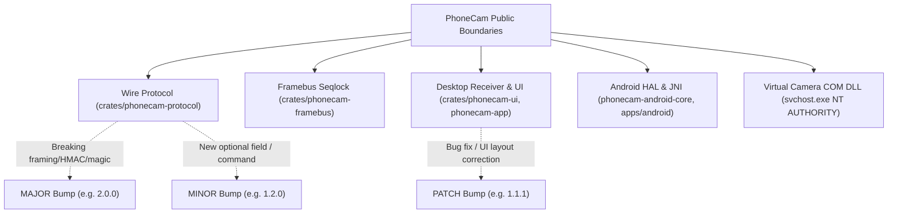

# PhoneCam Semantic Versioning (SemVer 2.0.0) & Semantic Release Guide

This skill guide provides the definitive standard for version management, Semantic Versioning 2.0.0 specification compliance, automated semantic release pipelines, Conventional Commits analysis, and multi-project version synchronization across the PhoneCam ecosystem (Rust workspace, Android Kotlin, Windows NSIS installer, and CI/CD automation).

---

## 1. Semantic Versioning 2.0.0 Specification (SemVer)

PhoneCam adheres strictly to the **[Semantic Versioning 2.0.0](https://semver.org/)** specification. The fundamental goal of SemVer is to communicate the risk and nature of software changes through a predictable, machine-parseable version number.

### 1.1 Version Number Format
A normal version number MUST take the form `X.Y.Z` where `X`, `Y`, and `Z` are non-negative integers and MUST NOT contain leading zeroes:

$$\text{Version} = \text{MAJOR} \,.\, \text{MINOR} \,.\, \text{PATCH}$$

- **MAJOR (`X`)**: Incremented when you make incompatible API or protocol changes.
- **MINOR (`Y`)**: Incremented when you add functionality in a backward-compatible manner, or deprecate public functionality.
- **PATCH (`Z`)**: Incremented when you make backward-compatible defect resolutions or bug fixes.

### 1.2 Pre-Release and Build Metadata Extensions

$$\text{Full Format} = \text{MAJOR} \,.\, \text{MINOR} \,.\, \text{PATCH} \, [-\, \text{PRERELEASE}] \, [+\, \text{BUILD}]$$

1. **Pre-Release Identifiers (`-PRERELEASE`)**:
   - Denoted by appending a hyphen `-` and a series of dot-separated identifiers immediately following the patch version.
   - Identifiers MUST comprise only ASCII alphanumerics and hyphens `[0-9A-Za-z-]`.
   - Numeric identifiers MUST NOT include leading zeroes.
   - **Correct SemVer 2.0.0**: `1.0.0-alpha.1`, `1.1.0-beta.2`, `1.2.0-rc.3`.
   - **Invalid Syntax**: `1.0.0a` (glued letters are invalid in SemVer; must use hyphen `-alpha`).
   - *Precedence*: A pre-release version has lower precedence than the associated normal version (e.g., `1.0.0-alpha` < `1.0.0`).

2. **Build Metadata (`+BUILD`)**:
   - Denoted by appending a plus sign `+` and a series of dot-separated identifiers.
   - Example: `1.1.0+20261114.sha.7c49441`.
   - *Precedence*: Build metadata is completely ignored when determining version precedence.

### 1.3 The 11 Cardinal Rules of SemVer 2.0.0

| Rule | Principle | Description |
| :---: | :--- | :--- |
| **1** | **X.Y.Z Format** | Non-negative integers: `MAJOR.MINOR.PATCH`. No leading zeroes (`1.01.0` is illegal). |
| **2** | **Initial Dev (`0.y.z`)** | Version `0.y.z` is for initial development. Anything MAY change at any time. |
| **3** | **Public API Definition** | Version `1.0.0` defines the public API. Subsequent increments depend strictly on how changes affect this API. |
| **4** | **Immutability** | Once a versioned release is published, the contents of that version MUST NOT be modified. Any alteration MUST be released as a new version. |
| **5** | **PATCH Increment** | Must be incremented if only backward-compatible bug fixes are introduced. Reset to `0` when MINOR or MAJOR increments. |
| **6** | **MINOR Increment** | Must be incremented if new, backward-compatible functionality or API deprecations are introduced. Resets PATCH to `0`. |
| **7** | **MAJOR Increment** | Must be incremented if any backward-incompatible changes are introduced to the public API or wire protocol. Resets MINOR and PATCH to `0`. |
| **8** | **Pre-Release Precedence** | Pre-release version indicates unstable release (e.g. `1.1.0-beta.1` < `1.1.0`). |
| **9** | **Build Metadata Ignored** | `1.1.0+exp.sha.123` has the same precedence as `1.1.0`. |
| **10** | **Precedence Calculation** | Evaluated left to right: `MAJOR` -> `MINOR` -> `PATCH`. If identical, compare dot-separated pre-release identifiers (integers compared numerically, strings compared lexically in ASCII order). |
| **11** | **Strict Monotonicity** | Subsequent releases MUST always have higher precedence than the previous release. |

---

## 2. PhoneCam Public API & Invariant Boundaries

To know whether to bump `MAJOR`, `MINOR`, or `PATCH`, understand PhoneCam's explicit Public API boundaries:



### 2.1 What Triggers a MAJOR Bump (`X.0.0`)
- **Protocol Wire Breaking Changes**: Modifying packet header magic (`0x5043414D`), changing HMAC-SHA256 signature algorithm, removing or altering mandatory fields in `DesktopToPhone` or `PhoneToDesktop`.
- **Shared Memory Header Incompatible Change**: Altering the 68-byte packed seqlock layout version (e.g., migrating from `layout_version = 2` to `3`).
- **JNI Signature Breakage**: Modifying native method signatures exported from `phonecam-android-core` to Kotlin JVM.
- **Virtual Camera Contract Change**: Changes requiring manual host OS driver re-registration or uninstalling existing virtual devices.

### 2.2 What Triggers a MINOR Bump (`1.X.0`)
- **Backward-Compatible New Features**:
  - Adding new optional camera controls (e.g., Anti-Flicker toggle, White Balance, Exposure compensation).
  - Unlocking 60 FPS streaming without breaking 30/24 FPS legacy clients.
  - Adding new telemetry fields (e.g. camera responsiveness RTT latency in `ms`).
  - Introducing a new audio channel or UDP discovery feature while preserving TCP fallback.
- **Deprecations**: Marking an existing protocol message or control option as deprecated.

### 2.3 What Triggers a PATCH Bump (`1.1.X`)
- **Backward-Compatible Bug Fixes**:
  - Fixing UI text clipping in the Setup panel.
  - Fixing zoom stepper / button truncation on small screen sizes.
  - Fixing Camera2 surface release ordering to prevent Android HAL crashes.
  - Resolving thread join deadlocks on encoder shutdown.
  - Resolving memory leaks or CPU spikes without altering public interfaces.

---

## 3. Semantic Release Workflow & Automation

PhoneCam integrates the core philosophy of **[Semantic Release](https://semantic-release.org/)**: fully automated version determination, release notes generation, asset aggregation, and publishing based on Conventional Commits.

### 3.1 The 7 Lifecycle Steps of Semantic Release

```
[ Commits Pushed to master ]
            │
            ▼
┌──────────────────────────────────────┐
│ 1. verifyConditions                  │  Check git credentials, GITHUB_TOKEN, release-gate.json
└──────────────────┬───────────────────┘
                   │
                   ▼
┌──────────────────────────────────────┐
│ 2. analyzeCommits                    │  Parse commits since last tag (HEAD..vX.Y.Z)
└──────────────────┬───────────────────┘
                   │  fix -> PATCH, feat -> MINOR, BREAKING -> MAJOR
                   ▼
┌──────────────────────────────────────┐
│ 3. verifyRelease                     │  Ensure new release is required and version > last_tag
└──────────────────┬───────────────────┘
                   │
                   ▼
┌──────────────────────────────────────┐
│ 4. generateNotes                     │  scripts/generate-release-notes.py generates changelog
└──────────────────┬───────────────────┘  with GitHub contributor avatars & commit categories
                   │
                   ▼
┌──────────────────────────────────────┐
│ 5. prepare                           │  Synchronize version across Cargo, Gradle, NSIS;
└──────────────────┬───────────────────┘  Compile binaries, installer, APKs, Linux tarball
                   │
                   ▼
┌──────────────────────────────────────┐
│ 6. publish                           │  Tag git repository (vX.Y.Z), create GitHub Release,
└──────────────────┬───────────────────┘  upload all multi-platform binary assets
                   │
                   ▼
┌──────────────────────────────────────┐
│ 7. closeGate                         │  Close release-gate.json (release_enabled = false)
└──────────────────────────────────────┘
```

### 3.2 Conventional Commits Mapping Matrix

Every commit message must follow: `<type>(<scope>): <short summary>`. Semantic release parses `<type>`:

| Commit Type | SemVer Release Impact | Example |
| :--- | :---: | :--- |
| `fix(...)` | **PATCH** | `fix(ui): prevent text clipping in setup panel` |
| `perf(...)` | **PATCH** | `perf(media): eliminate heap allocations in NV12 conversion` |
| `feat(...)` | **MINOR** | `feat(ui): add anti-flicker toggle and unlock 60fps streaming` |
| `feat(...)!` / `fix(...)!` | **MAJOR** | `feat(protocol)!: overhaul wire contract to support AV1 video` |
| `BREAKING CHANGE:` | **MAJOR** | Commit with `BREAKING CHANGE: ...` in the body footer |
| `docs(...)` | *None* (unless gate forced) | `docs(readme): update badges for v1.1.0` |
| `refactor(...)` | *None* (or PATCH) | `refactor(core): streamline session state machine` |
| `test(...)` | *None* | `test(ui): add interaction tests for zoom presets` |
| `ci(...)` | *None* | `ci(actions): update runner to windows-latest` |
| `chore(...)` | *None* | `chore(release): close release gate after v1.1.1` |

---

## 4. Multi-Project Version Synchronization Matrix

PhoneCam is a multi-language, multi-platform project. When bumping a version to `X.Y.Z`, **all 4 target files must stay in 100% lockstep**:

```
PhoneCam Workspace Version Sync:
├── 1. Cargo.toml                  [workspace.package] version = "X.Y.Z"
├── 2. apps/android/app/...        versionName = "X.Y.Z", versionCode = MAJOR*10000 + MINOR*100 + PATCH
├── 3. scripts/installer.nsi       OutFile "..\dist\installer\PhoneCam-Setup-X.Y.Z.exe" & DisplayVersion "X.Y.Z"
└── 4. release-gate.json           "version": "X.Y.Z", "release_enabled": true
```

### 4.1 Detailed Synchronization Checklist

#### 1. Rust Workspace (`Cargo.toml`)
```toml
[workspace.package]
version = "1.1.1"
```
Run `cargo check --workspace` to update `Cargo.lock` with the new version.

#### 2. Android Application (`apps/android/app/build.gradle.kts`)
Android requires both a human-readable `versionName` and a strictly monotonic 32-bit integer `versionCode`:
```kotlin
defaultConfig {
    // Formula: MAJOR * 10000 + MINOR * 100 + PATCH
    // e.g., 1.1.1 -> 1 * 10000 + 1 * 100 + 1 = 10101 (or 111 for short scheme)
    versionCode = 111
    versionName = "1.1.1"
}
```

#### 3. Windows NSIS Installer (`scripts/installer.nsi`)
```nsis
OutFile "..\dist\installer\PhoneCam-Setup-1.1.1.exe"
...
WriteRegStr HKLM "Software\Microsoft\Windows\CurrentVersion\Uninstall\PhoneCam" "DisplayVersion" "1.1.1"
```

#### 4. Release Gatekeeper (`release-gate.json`)
```json
{
  "release_enabled": true,
  "version": "1.1.1",
  "approved_by": "primahagantha",
  "allow_prerelease": false
}
```

---

## 5. Pre-Release Channels (`alpha`, `beta`, `rc`)

When publishing experimental builds:

1. **Alpha Channel (`1.2.0-alpha.1`)**:
   - For internal architectural testing and unstable protocol prototyping.
   - Set `"allow_prerelease": true` in `release-gate.json`.
2. **Beta Channel (`1.2.0-beta.1`)**:
   - Feature-complete, open for community testing.
3. **Release Candidate (`1.2.0-rc.1`)**:
   - Ready for final validation before stripping the pre-release tag to produce `1.2.0`.

> [!WARNING]
> Never use concatenated abbreviations like `1.0.0a` or `v1.0.0-b2`. SemVer 2.0.0 parsers (such as `cargo`, `npm`, `commitlint`, and `semantic-release`) reject non-dot-separated pre-release strings. Always use standard syntax: `1.0.0-alpha.1`.

---

## 6. Standard Step-by-Step Release Procedure

Follow this checklist to perform an authorized semantic release:

```powershell
# 1. Inspect recent commits and determine SemVer increment (PATCH, MINOR, or MAJOR)
git log -n 5 --oneline

# 2. Update version in Cargo.toml, apps/android/app/build.gradle.kts, scripts/installer.nsi
# 3. Authorize the release in release-gate.json ("release_enabled": true, "version": "X.Y.Z")

# 4. Validate formatting and tests
cargo fmt --all -- --check
cargo clippy --workspace --all-targets -- -D warnings
cargo test --workspace -j 2

# 5. Build local release binaries
cargo build --release -p phonecam-app --bin phonecam
Copy-Item target\release\phonecam.exe dist\unpacked\phonecam.exe -Force

# 6. Stage and commit with Conventional Commits
git add Cargo.toml Cargo.lock apps/android/app/build.gradle.kts scripts/installer.nsi release-gate.json dist/unpacked/phonecam.exe
git commit -m "chore(release): bump version to v1.1.1"

# 7. Push to master (GitHub Actions validates gate and compiles multi-platform release)
git push upstream master

# 8. Close release gatekeeper
# Edit release-gate.json -> set "release_enabled": false
git add release-gate.json
git commit -m "chore(release): close release gate after v1.1.1 publish authorization"
git push upstream master

# 9. Verify GitHub Actions Release
gh run view --repo primahagantha/phonecam
gh release view v1.1.1 --repo primahagantha/phonecam
```
