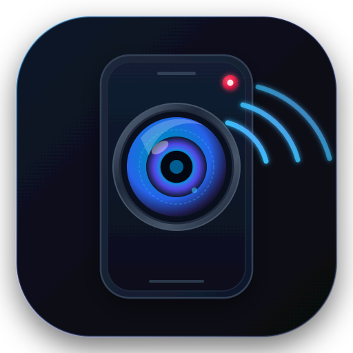
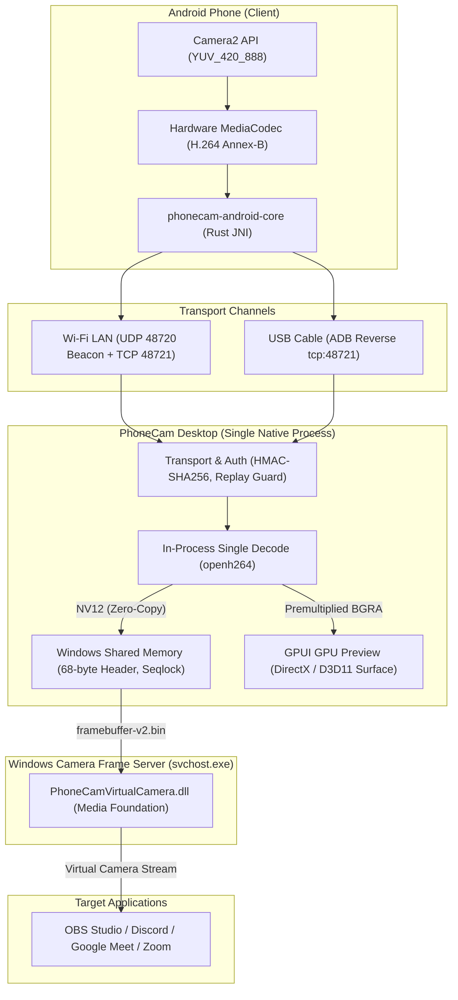
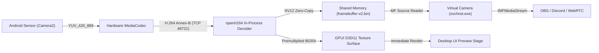
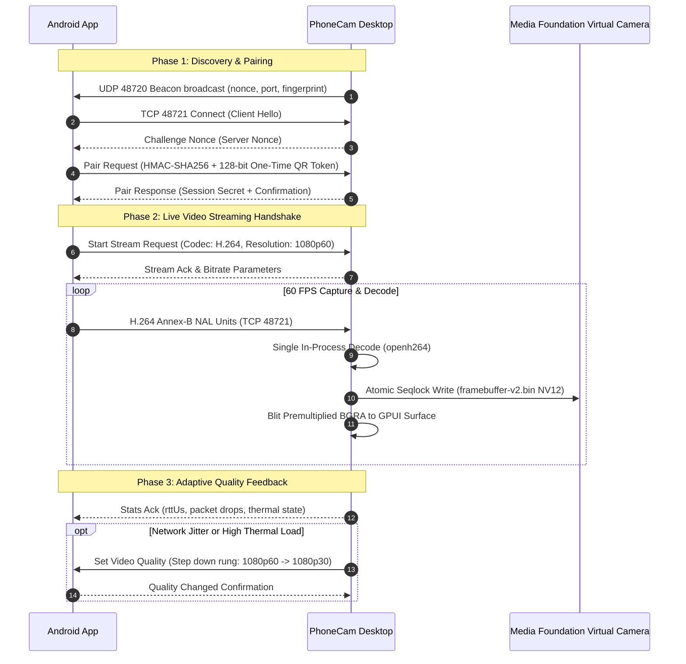

<p align="center">
  
</p>

<h1 align="center">PhoneCam</h1>

<p align="center">
  <strong>Turn any modern Android phone into a high-performance, studio-grade, ultra-low latency webcam for PC.</strong>
</p>

<p align="center">
  <a href="https://github.com/primahagantha/phonecam/actions/workflows/release.yml"></a>
  <a href="https://github.com/primahagantha/phonecam/releases/latest"></a>
  <a href="LICENSE"></a>
  <a href="#system-requirements"></a>
  <a href="#prerequisites"></a>
</p>

PhoneCam is a complete, native Rust rewrite of the desktop webcam companion. Engineered from the ground up with **GPUI**, **openh264**, **Windows Media Foundation**, and **Android Camera2 + MediaCodec**, PhoneCam delivers fluid 60 FPS streaming at minimal CPU and memory footprints with zero cloud dependencies.

---

## Table of Contents

- [Overview & Architecture](#overview--architecture)
- [Why Native Rust & GPUI (Comparison)](#why-native-rust--gpui-comparison)
- [Key Features](#key-features)
- [Dual Connection Modes](#dual-connection-modes)
- [Network Protocol & Port Reference](#network-protocol--port-reference)
- [System Requirements](#system-requirements)
- [Installation & Quick Start (Pre-Built Binaries)](#installation--quick-start-pre-built-binaries)
  - [1. Android APK Installation](#1-android-apk-installation)
  - [2. Windows Desktop Installation](#2-windows-desktop-installation)
  - [3. Linux Desktop Installation & Virtual Camera](#3-linux-desktop-installation--virtual-camera)
- [Building from Source](#building-from-source)
  - [Prerequisites](#prerequisites)
  - [1. Windows Desktop Application](#1-windows-desktop-application)
  - [2. Packaging the Windows NSIS Installer](#2-packaging-the-windows-nsis-installer)
  - [3. Android Native Rust JNI Core](#3-android-native-rust-jni-core)
  - [4. Android APK](#4-android-apk)
  - [5. Linux Desktop Application](#5-linux-desktop-application)
- [Virtual Camera Registration](#virtual-camera-registration)
- [Repository & Workspace Crates](#repository--workspace-crates)
- [Security & Privacy Guarantee](#security--privacy-guarantee)
- [Troubleshooting & FAQ](#troubleshooting--faq)
- [Contributing](#contributing)
- [Changelog](#changelog)
- [License](#license)

---

## Overview & Architecture

PhoneCam operates on a single-process, zero-copy philosophy. A connected Android device encodes raw sensor frames in hardware using `MediaCodec`, streaming H.264 Annex-B over a high-throughput TCP socket. The native desktop process receives the bitstream, executes a **single in-process decode** via `openh264`, and directly delivers the picture to both the Windows Virtual Camera and the local desktop preview window.



### Core Architecture Principles

1. **Single Decode Pipeline**: Previous Electron-based implementations decoded H.264 twice (once in C++ for the virtual camera and once via WebCodecs for GUI preview). PhoneCam decodes the bitstream **exactly once**. From that single decode, NV12 pixels are copied to shared memory and premultiplied BGRA pixels are pushed to the GPUI texture surface.



2. **Windows Shared Memory Framebus**: Video frames are transferred to the Media Foundation virtual camera via a zero-latency memory-mapped file (`C:\ProgramData\PhoneCam\framebuffer-v2.bin`) protected by an atomic seqlock. The virtual camera DLL runs inside Windows' `svchost.exe -k Camera` service.
3. **Hardware-Accelerated Android Capture**: The Android client hooks into the Android Camera2 NDK/Java APIs, binding directly to hardware `MediaCodec` encoders to stream Annex-B NAL units with low jitter.
4. **Resilient Reconnection**: If a network glitch occurs or the USB cable is unplugged, the virtual camera never crashes or unregisters from Windows. It continuously serves the last valid frame, transitions gracefully to a clean disconnected slate after 3 seconds, and automatically recovers the moment the phone reconnects.

---

## Why Native Rust & GPUI (Comparison)

| Metric / Attribute | Legacy Electron App | PhoneCam (Native Rust + GPUI) | Advantage |
| :--- | :--- | :--- | :--- |
| **Process Count** | 3 (Renderer, Main, C++ Core) | **1** (Unified binary) | No cross-process IPC failure modes |
| **Decodes per Stream**| 2 (WebCodecs + Media Foundation)| **1** (openh264 in-process) | **50% lower decode CPU load** |
| **Preview Latency** | ~24 ms (Mux MP4 to disk + read)| **< 1 ms** (Direct buffer to texture) | Instantaneous visual feedback |
| **Idle Memory (RAM)** | ~180 MB | **~40 MB** | **78% reduction in memory usage** |
| **Active Stream RAM** | ~350 MB | **~65 MB** | Extremely lightweight |
| **Installer Size** | ~140 MB (Chromium runtime) | **~9.5 MB** | Instant download and installation |
| **Startup Time** | ~2.5 - 4.0 seconds | **< 200 milliseconds** | Instant-launch experience |

---

## Key Features

- **High Framerate**: Rock-solid 60 FPS and 30 FPS capture and streaming with hardware pacing.
- **Dynamic Multi-Resolution**: Instant switching across 480p, 720p, 1080p, and 4K (sensor and hardware encoder permitting).
- **Adaptive Bitrate & Quality Ladder**: Automatically monitors round-trip latency (`rttUs`), packet drop rates, and phone thermal warnings. Steps smoothly down (`1080p60 -> 1080p30 -> 720p30 -> 480p30`) when congestion strikes, and cautiously scales back up when conditions clear.
- **Hardware Controls**:
  - **Smooth Digital Zoom**: Continuously adjustable digital crop.
  - **Flash / Torchlight**: Remote hardware torch toggle directly from desktop UI.
  - **Mirror / Flip**: Instant horizontal sensor reflection for natural webcam framing.
  - **Rotation**: 90°, 180°, and 270° orientation locking.
- **System Tray Integration**: Native Windows notification area tray icon (`Shell_NotifyIcon`) with background persistence on window close, quick mute, and camera toggle.
- **Accessible & Contrast-Compliant UI**: Full WCAG 2.1 AA 4.5:1 contrast compliance, tabular numbers (`tnum`) for jitter-free instrumentation, and keyboard navigation.

---

## Dual Connection Modes

PhoneCam supports both wireless freedom and tethered reliability using a single unified protocol:

### 1. USB Cable (Automatic ADB Reverse)
- **Zero Configuration**: Connect your phone via USB with USB Debugging enabled. PhoneCam automatically detects the connected device and runs `adb reverse tcp:48721 tcp:48721`.
- **Ultra-Low Latency**: Packets flow through the USB hardware bus over virtual loopback, immune to Wi-Fi channel crowding, packet loss, or radio interference.
- **Simultaneous Charging**: Keeps the mobile phone fully charged during multi-hour live streams or conferences.

### 2. Wi-Fi Local Area Network (LAN)
- **Automatic UDP Beacon Discovery**: The desktop broadcasts an encrypted UDP beacon on port `48720`. The Android app detects the desktop instantly when connected to the same Wi-Fi subnet.
- **QR Code Pairing**: Scan a cryptographically secure, one-time pairing QR code rendered on the desktop stage to establish an authenticated pairing in seconds.

### Pairing & Live Streaming Handshake



---

## Network Protocol & Port Reference

| Port / Interface | Protocol | Direction | Purpose | Notes |
| :--- | :--- | :--- | :--- | :--- |
| **48720** | UDP | Phone ⇄ Desktop | LAN Discovery Beacon | Periodic presence beacon broadcast |
| **48721** | TCP | Phone → Desktop | Primary Service & Video Stream | Length-prefixed JSON control & H.264 video |
| **48723** | TCP | *Eliminated* | Legacy Loopback IPC | Removed in Rust rewrite; no longer used |

### Environment Variable Overrides
If another application or legacy service binds to port 48721, PhoneCam can be directed to bind an alternate port:
```powershell
$env:PHONECAM_PORT = 48791
.\phonecam.exe
```
When `PHONECAM_PORT` is specified, the QR pairing code and UDP beacon automatically advertise the updated port to incoming clients.

---

## System Requirements

### Desktop (Receiver & Virtual Camera)
- **Windows 11 (Build 22621+)**: Native Windows Media Foundation Virtual Camera (`MFCreateVirtualCamera`).
- **Windows 10 (Version 1809+, Build 17763+)**: Full desktop companion app, preview, audio, hardware controls, and DirectShow COM Virtual Camera driver (`PhoneCamVirtualCamera.dll` via `phonecam-vcam-register.exe`).
- **Linux (Ubuntu/Debian, Fedora, Arch Linux)**: Supported via native build and `v4l2loopback` virtual video device.
- **macOS (Apple Silicon & Intel x86_64)**: Supported via native build (Metal backend) and CoreMediaIO DAL plugin / Camera Extension.
- **Processor & GPU**: 64-bit Intel, AMD, or ARM64 processor; DirectX 11 / Metal / Vulkan compatible GPU.
- For detailed multi-platform architecture and build matrices, see [docs/platform-support.md](docs/platform-support.md).

### Android Phone (Sender & Camera)
- **Operating System**: Android 8.0 (Oreo, API Level 26) or newer.
- **Architectures**: arm64-v8a (primary), armeabi-v7a (legacy 32-bit), x86_64 (emulators).
- **Camera Hardware**: Camera2 API support with hardware H.264 `MediaCodec` encoder.
- **Permissions**: Camera (`android.permission.CAMERA`), Local Network / Wi-Fi state, Foreground Service.

---

## Installation & Quick Start (Pre-Built Binaries)

For everyday users who do not need to compile from source, pre-built binary releases are available on the [GitHub Releases](https://github.com/primahagantha/phonecam/releases/latest) page.

### 1. Android APK Installation
1. Download **`PhoneCam.apk`** (Universal bundle) or the architecture-specific APK (`PhoneCam-arm64-v8a.apk` for modern phones) from the [Latest Release](https://github.com/primahagantha/phonecam/releases/latest).
2. Install the APK on your Android device (ensure "Install unknown apps" permission is granted to your browser/file manager).
3. Open PhoneCam and grant Camera and Local Network permissions.

### 2. Windows Desktop Installation
1. Download **`PhoneCam-Setup-1.1.1.exe`** (or portable ZIP `PhoneCam-v1.1.1-windows-x64.zip`).
2. Run the installer and launch PhoneCam.
3. **Virtual Camera Activation**: In the PhoneCam app, toggle the Virtual Camera switch. The application automatically triggers a native Windows UAC elevation prompt to register `PhoneCamVirtualCamera.dll` into the system registry without requiring manual terminal commands. Once approved, "PhoneCam Camera" is immediately enumerable in OBS Studio, Google Meet, Zoom, and Discord.

### 3. Linux Desktop Installation & Virtual Camera
Pre-compiled Linux binaries are packaged as standalone tarballs (`PhoneCam-v1.1.1-linux-x64.tar.gz`). Linux uses `v4l2loopback` for the virtual video device (`/dev/video10`).

#### Automated Setup (One-Click)
Run our automated setup script to install all development and runtime dependencies, load `v4l2loopback`, configure boot persistence, and apply non-root udev access rules:
```bash
git clone https://github.com/primahagantha/phonecam.git
cd phonecam
chmod +x scripts/setup-linux.sh
./scripts/setup-linux.sh
```

#### Manual Package Prerequisites by Distribution
If you prefer installing dependencies manually:

- **Ubuntu / Debian / Linux Mint**:
  ```bash
  sudo apt-get update && sudo apt-get install -y --no-install-recommends \
      build-essential pkg-config libfontconfig1-dev libfreetype6-dev \
      libasound2-dev libx11-dev libx11-xcb-dev libxcb1-dev libxcursor-dev \
      libxrandr-dev libxi-dev libxkbcommon-dev libxkbcommon-x11-dev \
      libwayland-dev libvulkan-dev libssl-dev v4l2loopback-dkms v4l-utils android-tools-adb
  ```

- **Fedora / RHEL / CentOS Stream**:
  ```bash
  sudo dnf install -y \
      gcc gcc-c++ pkgconf-pkg-config fontconfig-devel freetype-devel \
      alsa-lib-devel libX11-devel libXcursor-devel libXrandr-devel \
      libXi-devel libxkbcommon-devel libxkbcommon-x11-devel wayland-devel \
      vulkan-loader-devel openssl-devel v4l2loopback v4l-utils android-tools
  ```

- **Arch Linux / Manjaro**:
  ```bash
  sudo pacman -S --needed --noconfirm \
      base-devel pkgconf fontconfig freetype2 alsa-lib libx11 \
      libxcursor libxrandr libxi libxkbcommon libxkbcommon-x11 \
      wayland vulkan-icd-loader openssl v4l2loopback-dkms v4l-utils android-tools
  ```

#### Virtual Camera Module Configuration (`v4l2loopback`)
```bash
# 1. Load module with device label and fixed device node
sudo modprobe v4l2loopback devices=1 video_nr=10 card_label="PhoneCam" exclusive_caps=1

# 2. Persist module on boot:
echo "v4l2loopback" | sudo tee /etc/modules-load.d/v4l2loopback.conf
echo 'options v4l2loopback devices=1 video_nr=10 card_label="PhoneCam" exclusive_caps=1' | sudo tee /etc/modprobe.d/v4l2loopback.conf

# 3. Allow non-root access for OBS, Chrome, Meet, and Zoom:
sudo usermod -aG video,plugdev $USER
echo 'KERNEL=="video10*", SUBSYSTEM=="video4linux", ATTR{name}=="PhoneCam*", MODE="0666", GROUP="video"' | sudo tee /etc/udev/rules.d/99-phonecam-vcam.rules
sudo udevadm control --reload-rules && sudo udevadm trigger
```

---

## Building from Source

### Prerequisites

Ensure the following toolchains are installed on your workstation:

1. **Rust Toolchain**: Rust 1.85 or newer (`stable-x86_64-pc-windows-msvc`).
   ```powershell
   rustup default stable-x86_64-pc-windows-msvc
   ```
2. **Visual Studio C++ Build Tools**: Visual Studio 2022 with the "Desktop development with C++" workload and Windows 11 SDK (10.0.22621.0+).
3. **Nullsoft Scriptable Install System (NSIS)**: Version 3.08+ (needed for installer generation). Add `makensis.exe` to your system `PATH`.
4. **Java Development Kit (JDK)**: OpenJDK 17 or Oracle JDK 17 (`JAVA_HOME` set).
5. **Android SDK & NDK**:
   - Android SDK Command-line Tools / Build Tools (34.0.0+).
   - Android NDK (r26c or r28+, e.g. `28.2.13676358`).
   - Set environment variables `ANDROID_HOME` and `ANDROID_NDK_HOME`.
6. **cargo-ndk**:
   ```powershell
   cargo install cargo-ndk
   ```
   Add Android Rust targets:
   ```powershell
   rustup target add aarch64-linux-android armv7-linux-androideabi x86_64-linux-android
   ```

---

### 1. Windows Desktop Application

To compile the native Windows desktop executable in release mode:

```powershell
# Clone the repository
git clone https://github.com/phonecam/phonecam.git
cd phonecam

# Run workspace unit and integration tests (230+ tests)
cargo test --workspace

# Build the release binary
cargo build --release -p phonecam-app
```
The compiled executable will be located at:
`target\release\phonecam.exe`

---

### 2. Packaging the Windows NSIS Installer

To generate the standalone `PhoneCam-Setup-1.0.0.exe` installer:

```powershell
# 1. Ensure dist\unpacked contains the required binaries:
#    - phonecam.exe (from target\release\phonecam.exe)
#    - PhoneCamVirtualCamera.dll
#    - phonecam-vcam-register.exe
#    - adb.exe, AdbWinApi.dll, AdbWinUsbApi.dll
#    - icon.ico

Copy-Item target\release\phonecam.exe dist\unpacked\phonecam.exe

# 2. Compile installer using NSIS
makensis scripts\installer.nsi
```
The completed installer will be output to:
`dist\installer\PhoneCam-Setup-1.1.0.exe`

#### Standalone Portable Release
To run PhoneCam portably without system-wide installation:
1. Extract `dist\PhoneCam-v1.1.0-windows-x64.zip` (or navigate to `dist\unpacked\`).
2. Run `run-portable.bat` to launch `phonecam.exe` with bundled local dependency checks.
3. For virtual camera registration in OBS/Zoom/Meet, run `install-virtual-camera.bat` as Administrator.

#### Release Gatekeeper & Automated Changelog
PhoneCam includes an automated release gate so normal commits do not accidentally publish releases:
- **Release Gate (`release-gate.json`)**: Default is `"release_enabled": false`. Commits to `master` build and test across CI, but will not publish a public release.
- **Enabling a Release**: Set `"release_enabled": true` in `release-gate.json` and push. GitHub Actions automatically executes the multi-platform matrix (Windows NSIS + portable ZIP, Linux standalone tarball, Android multi-ABI APKs) and publishes the GitHub release.
- **Contributor Transparency**: Every release automatically generates changelogs grouped by category (Features, Fixes, Performance, Refactor, Docs, CI) and credits all contributors with their live GitHub avatar profiles.

---

### 3. Android Native Rust JNI Core

The Android app utilizes `crates/phonecam-android-core` for high-performance JNI operations. Compile the cross-platform native `.so` shared libraries:

```powershell
# Compiles JNI shared libraries for arm64-v8a, armeabi-v7a, and x86_64
.\scripts\build-android-core.ps1
```
This script automatically compiles the native code and populates:
`apps\android\app\src\main\jniLibs\<ABI>\libphonecam_android_core.so`

---

### 4. Android APK

Compile the Android APK using Gradle:

```powershell
cd apps\android

# Run JVM and Android unit tests
.\gradlew.bat test

# Build debug APK
.\gradlew.bat assembleDebug

# Build production release APK
.\gradlew.bat assembleRelease
```
The generated APKs will be placed in `apps\android\app\build\outputs\apk\release\`:
- `app-arm64-v8a-release.apk` (~2.36 MB, optimized for 64-bit ARM)
- `app-armeabi-v7a-release.apk` (~2.14 MB, optimized for 32-bit ARM)
- `app-x86_64-release.apk` (~2.34 MB, optimized for x86_64 emulators)
- `app-universal-release.apk` (~3.75 MB, universal bundle containing all native ABIs, copied to `dist\PhoneCam.apk`)

---

### 5. Linux Desktop Application

Once the Linux prerequisites are installed (or after running `./scripts/setup-linux.sh`):

```bash
# Run workspace core, protocol, and media tests
cargo test -p phonecam-core -p phonecam-media -p phonecam-protocol -p phonecam-android-core

# Build release desktop binary
cargo build --release -p phonecam-app
```
The compiled Linux executable will be located at:
`target/release/phonecam`

---

## Virtual Camera Registration

### Windows (Automatic Elevation & CLI)
On Windows 11 and Windows 10, PhoneCam automatically elevates via native Win32 UAC when toggled in the desktop GUI. If you prefer to register or inspect the COM server via CLI, open an elevated (Administrator) terminal:

```powershell
# Register the virtual camera driver
.\dist\unpacked\phonecam-vcam-register.exe --register

# Verify registration and Media Foundation source enumeration
.\dist\unpacked\phonecam-vcam-register.exe --status

# To unregister:
.\dist\unpacked\phonecam-vcam-register.exe --unregister
```

### Linux (v4l2loopback Device Node)
On Linux, the virtual camera is mediated by the `v4l2loopback` kernel module:
```bash
# Verify active loopback device
v4l2-ctl --device=/dev/video10 --all

# List video capture devices
v4l2-ctl --list-devices
```

---

## Repository & Workspace Crates

The PhoneCam repository is organized as a unified Rust cargo workspace:

```
phonecam/
├── apps/
│   └── android/                   # Android Camera2 application (Kotlin + Gradle)
├── crates/
│   ├── phonecam-protocol/         # Frozen wire contract: framing, crypto HMAC, JSON models
│   ├── phonecam-framebus/         # Shared memory seqlock writer & NV12 pitch conversion
│   ├── phonecam-media/            # openh264 in-process decoder, SPS parsing, pacer
│   ├── phonecam-core/             # Transport listeners, pairing state, adaptive bitrate ladder
│   ├── phonecam-ui/               # GPUI design system, tokens, preview stage, instrument panels
│   ├── phonecam-app/              # Native desktop binary: main entry, win32 tray, adb driver
│   └── phonecam-android-core/     # Native JNI shared library for Android client
├── dist/                          # Packaged installers and release binaries
├── docs/                          # Architecture blueprints and design documentation
└── scripts/                       # NSIS installer script and cross-compilation helpers
```

---

## Security & Privacy Guarantee

- **Zero Cloud Infrastructure**: PhoneCam never transmits telemetry, audio, or video across the internet. All communication occurs strictly within your local network or through the physical USB cable.
- **Cryptographic Pairing**: Devices pair using ephemeral 128-bit CSPRNG tokens that expire in 5 minutes and require explicit on-screen user approval on the desktop.
- **HMAC-SHA256 Authentication**: Every subsequent session is verified using a shared 256-bit secret and authenticated against strictly increasing nonces to make replay attacks mathematically impossible.
- **Automated Log Redaction**: The internal logger runs an aggressive redaction filter that automatically strips out any 32- or 64-character hexadecimal tokens from debug logs, ensuring secrets are never leaked into log files.

---

## Troubleshooting & FAQ

### 1. The phone does not detect the PC over USB
- Ensure **USB Debugging** is toggled ON under Android Developer Options.
- Confirm that your phone displays the *"Allow USB debugging from this computer?"* authorization modal and select "Always allow".
- Verify connectivity in your terminal by running `adb devices`.

### 2. Virtual Camera does not show up in Discord / OBS / Zoom
- Ensure you have run `phonecam-vcam-register.exe --register` from an elevated (Administrator) command prompt.
- Confirm you are running **Windows 11 Build 22621** or later (`winver`).
- Restart the consumer application (e.g. OBS or Discord) after registering the camera.

### 3. Port 48721 is already in use
- If a legacy version of PhoneCam or another server is holding port 48721, launch PhoneCam with an override:
  ```powershell
  $env:PHONECAM_PORT = 48791
  .\phonecam.exe
  ```

### 4. UDP Discovery does not find the desktop on Wi-Fi
- Verify both devices are connected to the same subnet and that your router does not have "AP Isolation" or "Client Isolation" enabled.
- Check the Windows Defender Firewall prompt to ensure PhoneCam has permission to listen on Private networks.
- You can always pair instantly by scanning the QR code on the desktop screen.

---

## Contributing

We welcome contributions from the open-source community! Please review [CONTRIBUTING.md](CONTRIBUTING.md) for our code style guidelines, semantic commit standards, testing requirements, and Pull Request workflow.

---

## Changelog

For a complete record of releases, features, bug fixes, and architectural milestones, see [CHANGELOG.md](CHANGELOG.md).

---

## License

PhoneCam is dual-licensed under either:

- **Apache License, Version 2.0** ([LICENSE-APACHE](LICENSE-APACHE) or http://www.apache.org/licenses/LICENSE-2.0)
- **MIT License** ([LICENSE-MIT](LICENSE-MIT) or http://opensource.org/licenses/MIT)

at your option. See [LICENSE](LICENSE) for full details.
