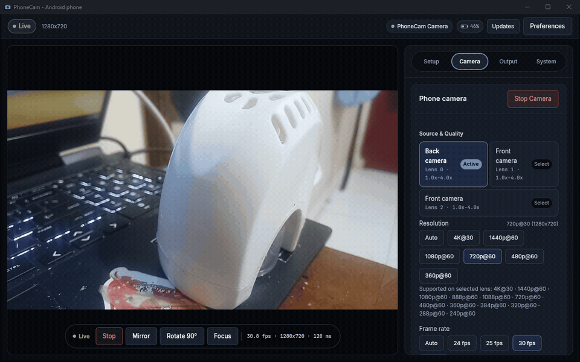
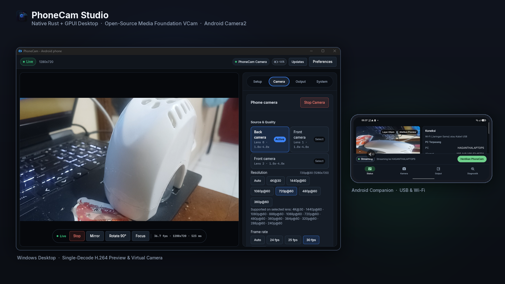

<p align="center">
  
</p>

<h1 align="center">PhoneCam</h1>

<p align="center">
  <strong>Free, 100% Open-Source Android Webcam for Windows &amp; Linux — Native Rust Alternative to DroidCam, Iriun &amp; Camo</strong>
</p>

<p align="center">
  Turn your Android phone into a low-latency 1080p60 / 4K PC webcam over USB or Wi-Fi. Built as a single native Rust + GPUI desktop binary (~50 MB RAM) with an open-source C++ Windows Media Foundation virtual camera — no 480p paywall, no watermark, no ads, and zero telemetry.
</p>

<p align="center">
  <a href="https://github.com/primahagantha/phonecam/actions/workflows/ci.yml"></a>
  <a href="https://github.com/primahagantha/phonecam/releases"></a>
  <a href="LICENSE"></a>
  
  
</p>

<p align="center">
  
</p>

<p align="center">
  
</p>

---

## Why PhoneCam? (Comparison)

Most Android-to-PC webcam apps lock 1080p/60fps behind subscriptions, stamp watermarks on free streams, or ship closed-source virtual camera drivers. PhoneCam is 100% open source from the Android Camera2 encoder to the Windows Media Foundation virtual camera DLL.

| Capability | **PhoneCam** | DroidCam | Iriun | Camo | scrcpy |
| :--- | :---: | :---: | :---: | :---: | :---: |
| **100% Open Source (incl. VCam)** | **Yes (MIT / Apache-2.0)** | Partial (proprietary client/driver) | No | No | Yes (Apache-2.0) |
| **Watermark-Free** | **Always** | Free tier / Pro | Watermarked on free | Watermarked on free | Always |
| **No Resolution / 60 FPS Paywall** | **Up to 4K@30 & 1080p@60 free** | 480p free; HD/60fps paid | Paid for unwatermarked HD | 720p free; 1080p/4K paid | Unlimited (CLI) |
| **Desktop Footprint** | **~50 MB RAM (single Rust binary)** | Native / OBS plugin | Light native | Heavy desktop studio | Minimal CLI |
| **USB + Wi-Fi Transport** | **Unified TCP + auto `adb reverse` + QR** | USB + Wi-Fi | USB + Wi-Fi | USB + Wi-Fi | USB + TCP/IP |
| **Manual Camera2 Controls** | **Multi-lens, EV, Kelvin WB, Focus, Anti-Flicker** | Pro / limited | Limited | Pro tier | CLI flags only |
| **Built-in Update Checker** | **Opt-in GitHub Releases + Changelog** | Manual / store | Manual | Auto-updater | Manual / pkg mgr |

---

## Quick Start (Windows 11 + Android)

1. **Install PhoneCam Desktop (Windows 11 x64)** — download from [GitHub Releases](https://github.com/primahagantha/phonecam/releases):
   - **Installer (`PhoneCam-Setup-<version>.exe`)**: installs `phonecam.exe`, `adb.exe`, and `PhoneCam.apk`, registers the open-source Windows Media Foundation virtual camera, and configures local Windows Firewall rules (`TCP 48721`, `UDP 48720`).
   - **Portable Zip (`PhoneCam-<version>-windows-x64.zip`)**: extract, right-click `install-virtual-camera.bat` -> **Run as administrator**, then launch `run-portable.bat`.
2. **Install PhoneCam Android (`PhoneCam.apk`)**:
   - Sideload `PhoneCam.apk` from Releases (Android 8.0 / API 26+), **or** plug in your phone via USB with **USB Debugging** enabled and click **Install app on phone** inside the desktop Setup tab (automatically recovers from APK signature mismatches).
3. **Connect & Go Live**:
   - **USB (lowest jitter)**: plug in your USB cable — PhoneCam automatically bridges `adb reverse tcp:48721 tcp:48721`.
   - **Wi-Fi (zero cables)**: keep PC and phone on the same LAN and scan the desktop QR code from the Android app.
   - Select **PhoneCam Camera** in **OBS Studio, Zoom, Discord, Microsoft Teams, Google Meet**, or any browser WebRTC app.

---

## Key Features

- **Low-Latency Single-Decode Pipeline & Open-Source Virtual Camera**: H.264 Annex-B bitstreams are decoded exactly once in-process via `openh264`, feeding both the GPUI DirectX 11 preview and a zero-allocation 68-byte seqlock shared-memory framebus (`PhoneCamVirtualCamera.dll`). Uses `TCP_NODELAY`, bounded socket buffers, Android `KEY_OPERATING_RATE`, and a 3-second disconnect hold slate so Zoom/OBS/Meet never drop your camera.
- **60 FPS High-Speed Camera2 & Manual Pro Controls**: Dynamic `StreamConfigurationMap` & Camera2 high-speed session negotiation (`[60,60]` / `[30,60]` / `[30,120]` AE FPS ranges) up to 4K@30 and 1080p@60. Seamlessly switch physical lenses (`0.5x`, `1.0x`, `3.0x`, Front) and tune Exposure EV, White Balance Kelvin, Focus diopter, `50Hz`/`60Hz`/`Auto` Anti-Flicker, rotation/mirror, and 0-nit pure-black OLED blackout mode without dropping the stream.
- **Native Rust + GPUI Studio UI with Bundled Fonts**: Hardware-accelerated DirectX 11 dark obsidian Studio UI with embedded **Inter** and **JetBrains Mono** fonts (zero missing-font errors on clean Windows installs), tabular-figure live telemetry (`FPS`, resolution, glass-to-glass ms), keyboard shortcuts (`Ctrl+1..4`, `Space`, `F11`), and minimize-to-tray background streaming.
- **Audio Monitor & Windows `waveOut` / VB-Cable Routing**: Uncompressed 16-bit PCM (`48 kHz` / `16 kHz`) multiplexed over `ChannelRole::Audio = 3` drives a 16-segment logarithmic dBFS LED VU meter and routes via WinMM `waveOut` to **VB-Audio Virtual Cable (`CABLE Input`)** or Windows playback devices (native kernel virtual mic driver is on the Roadmap).
- **On-Device Labs Effects (Preview + VCam Parity)**: Zero-allocation pure-Rust face auto-framing, 6 touchless hand gestures, separable portrait bokeh blur, and color LUT presets applied consistently to both preview and Virtual Camera output. See [docs/pro-features.md](docs/pro-features.md).
- **Opt-In GitHub Update Checker (Desktop & Android)**: Check for new GitHub Releases with SemVer 2.0.0 comparison and inline release notes directly inside both apps. Strictly user-initiated — never runs on startup or background timers.
- **100% Local-Only & Zero Telemetry**: Works completely offline on air-gapped LANs or USB. Pairing uses a 128-bit single-use QR token (5-minute TTL), persistent 256-bit device secrets (`%APPDATA%\PhoneCam\devices.json`), `HMAC-SHA256`, strictly monotonic replay nonces, and automatic hex-secret log redaction.

---

## Platform Support

| Platform | Status | Implementation |
| :--- | :--- | :--- |
| **Windows 11 (`22621+` x64)** | **Supported** | GPUI (DirectX 11) + `openh264` + open-source C++ Media Foundation VCam (`native/virtual-camera/`, `MFCreateVirtualCamera`) + WinMM `waveOut` audio routing. |
| **Android (`API 26+`)** | **Supported** | Kotlin + Jetpack Compose + Camera2 + hardware `MediaCodec` H.264 + `phonecam-android-core` Rust JNI (`arm64-v8a`, `armeabi-v7a`, `x86_64`). |
| **Linux (`v4l2loopback`)** | **Experimental** | `phonecam-framebus` writes NV12 to `/dev/video10` (`PHONECAM_V4L2_DEVICE`) via `v4l2loopback` `ioctl`; full desktop crates compile in Linux CI (live hardware pass pending). |
| **Windows 10 / macOS / iOS** | **Roadmap** | DirectShow COM (Win10), CoreMediaIO extension (macOS), native kernel virtual mic driver, and iOS client planned. See [docs/platform-support.md](docs/platform-support.md). |

---

## Architecture at a Glance

```text
Android (Camera2 + MediaCodec H.264 + AudioRecord PCM)
   └──► TCP 48721 (Wi-Fi LAN or USB adb reverse, TCP_NODELAY)
           └──► phonecam.exe (Single Native Rust + GPUI Process)
                   ├── openh264 Single In-Process Decode (BT.709 HD / BT.601 SD)
                   ├── NV12 (direct or Labs FX) ──► 68B Seqlock SHM ──► PhoneCamVirtualCamera.dll (C++)
                   ├── Premultiplied BGRA ──► GPUI DirectX 11 Preview
                   └── 16-bit PCM ──► 16-Segment dBFS VU Meter + Windows waveOut (VB-Cable / Speakers)
```

All components — Rust workspace (`crates/`), C++17 Media Foundation virtual camera (`native/virtual-camera/`, `native/shared/`), and Android client (`apps/android/`) — are 100% open source with zero prebuilt `.dll`/`.exe` binaries tracked in Git. See [docs/architecture.md](docs/architecture.md) for full details.

---

## Building from Source

### Prerequisites
- **Rust** `1.85+` (stable)
- **Windows 11 x64**: MSVC Build Tools (C++17), CMake `3.20+`, Windows 11 SDK `10.0.26100+` (`mfvirtualcamera.h`), and [NSIS](https://nsis.sourceforge.io/) (optional, for installer packaging)
- **Android**: JDK 17, Android SDK (API 34), Android NDK + `cargo-ndk` (if rebuilding `.so` JNI libraries)

### Desktop & Open-Source Virtual Camera (Windows)
```powershell
# 1. Compile C++ Media Foundation Virtual Camera DLL + registrar into dist/unpacked/
.\scripts\build-vcam.ps1

# 2. Fetch/stage official Google ADB tools (adb.exe, AdbWinApi.dll, AdbWinUsbApi.dll)
.\scripts\fetch-adb.ps1

# 3. Verify, test, and launch the desktop app
cargo check --workspace
cargo clippy --workspace --all-targets -- -D warnings
cargo test --workspace
cargo run -p phonecam-app
```

### Android App & JNI Core
```powershell
# Optional: rebuild Rust JNI .so libraries for arm64-v8a, armeabi-v7a, x86_64
.\scripts\build-android-core.ps1

# Optional: configure a persistent release keystore outside the repo
.\scripts\setup-android-signing.ps1

# Run JVM unit tests and build release APKs
cd apps\android
.\gradlew.bat test
.\gradlew.bat assembleRelease
```

---

## Frequently Asked Questions (FAQ)

<details>
<summary><strong>How do I use my Android phone as a 1080p or 60 FPS webcam without a watermark?</strong></summary>
Install PhoneCam Desktop on Windows 11 and PhoneCam APK on Android, connect via USB or Wi-Fi, open the <strong>Camera</strong> tab, and pick any supported resolution/framerate preset (such as <code>1080p@60</code> or <code>4K@30</code>). Every resolution and framerate your phone's Camera2 sensor supports is unlocked with zero watermarks or subscriptions.
</details>

<details>
<summary><strong>Does PhoneCam work with OBS Studio, Zoom, Discord, Microsoft Teams, and Google Meet?</strong></summary>
Yes. Once the virtual camera is registered (automatic in the installer, or via <code>install-virtual-camera.bat</code> in the portable zip), <strong>PhoneCam Camera</strong> appears as a standard Windows camera device in OBS, Zoom, Discord, Teams, Google Meet, Chrome, Edge, and Firefox.
</details>

<details>
<summary><strong>Can I use PhoneCam over USB with no Wi-Fi or internet connection?</strong></summary>
Yes. PhoneCam is offline-first and requires zero internet access. Enable <strong>USB Debugging</strong> on Android and connect a USB data cable; PhoneCam automatically forwards <code>adb reverse tcp:48721 tcp:48721</code> for jitter-free wired video and audio.
</details>

<details>
<summary><strong>How do I use my Android phone's microphone in Zoom, Discord, or OBS?</strong></summary>
PhoneCam streams uncompressed 48 kHz / 16 kHz PCM audio from your phone. Open the <strong>Output</strong> tab, install <a href="https://vb-audio.com/Cable/">VB-Audio Virtual Cable</a>, select <code>CABLE Input</code> as PhoneCam's audio output device, and pick <code>CABLE Output</code> as your microphone in OBS, Zoom, or Discord.
</details>

<details>
<summary><strong>Why does Windows require Windows 11 (Build 22621+)?</strong></summary>
PhoneCam's open-source virtual camera uses Microsoft's user-mode Media Foundation <code>MFCreateVirtualCamera</code> API introduced in Windows 11, avoiding invasive unsigned kernel drivers. DirectShow COM support for Windows 10 is tracked on the roadmap.
</details>

<details>
<summary><strong>Does PhoneCam collect analytics or send video to any cloud server?</strong></summary>
Never. All H.264 decoding, auto-framing, bokeh blur, color LUTs, and virtual camera streaming execute 100% locally on your LAN or USB cable. Even the built-in GitHub Release update checker only makes an HTTPS request to <code>api.github.com</code> when you explicitly click <strong>Check for Updates</strong>.
</details>

---

## Documentation & Troubleshooting

- **Docs**: [Architecture](docs/architecture.md) · [Platform Support](docs/platform-support.md) · [Pro & Labs Features](docs/pro-features.md) · [Changelog](CHANGELOG.md)
- **Wi-Fi discovery fails**: Ensure PC and phone share the same subnet (guest Wi-Fi / client isolation blocks UDP `48720` and TCP `48721`), allow `phonecam.exe` on Private networks in Windows Firewall, or scan the QR code directly.
- **USB not detected**: Enable **Developer options -> USB debugging** on Android and accept the RSA authorization prompt on the phone screen.
- **Camera missing in Zoom/OBS/Discord**: Check `phonecam-vcam-register.exe --status` (or run `install-virtual-camera.bat` as Administrator). Requires Windows 11 Build `22621+`.
- **Port conflict (`48721`)**: Override the listening port via `$env:PHONECAM_PORT = "48791"`.

---

## Contributing & License

Contributions, bug reports, and platform PRs are welcome — see [CONTRIBUTING.md](CONTRIBUTING.md) and [CHANGELOG.md](CHANGELOG.md). Commits follow [Conventional Commits](https://www.conventionalcommits.org/).

Dual-licensed under [MIT](LICENSE-MIT) or [Apache-2.0](LICENSE-APACHE) at your option (see [LICENSE](LICENSE)).
