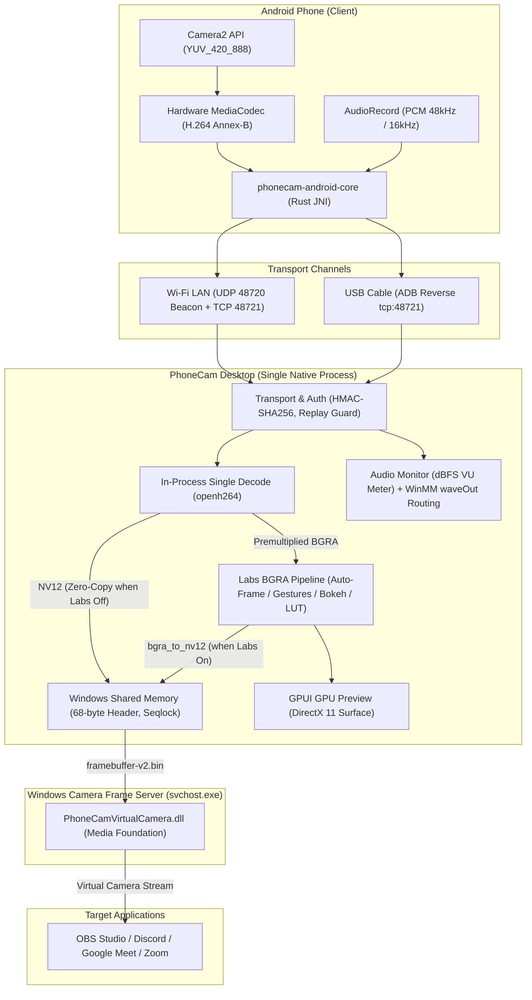
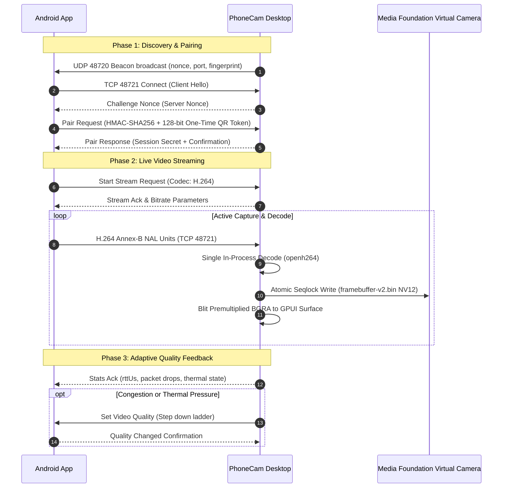

# PhoneCam Architecture (Rust + GPUI)

This document explains how the pieces fit together and **why** each boundary sits where it does — including the ones that were moved from the legacy Electron build and the ones that were kept.

---

## 1. The one-sentence shape

> A phone captures and encodes; one native Rust process decodes once and publishes to two places: the Windows virtual camera framebus and its own GPUI window.

---

## 2. What moved, and what did not

### The decode is single

The legacy Electron build decoded the stream **twice**: a C++ core decoded to NV12 for the virtual camera, and the renderer decoded the phone's original H.264 again with WebCodecs for the preview. That meant two decoders, two failure modes, and an IPC hop carrying the bitstream.

In PhoneCam, `openh264` runs once in `phonecam-media`. Its decoded planar YUV420P output goes to `phonecam-framebus` as NV12 and to the GPUI window as premultiplied BGRA.

### In-process decoding vs temp-file muxing

The legacy C++ core muxed each group of pictures into a fragmented MP4 on disk and read it back through a Media Foundation Source Reader (~24 ms overhead per batch). `phonecam-media` decodes H.264 Annex-B directly in process via `openh264` — no container, no temp file, and independent of machine-installed MFTs.

### The virtual camera DLL is separate, on purpose

Windows instantiates software camera sources **itself** inside the Camera Frame Server process (`svchost.exe -k Camera`, running as `NT AUTHORITY\LocalService`). `PhoneCamVirtualCamera.dll` is loaded there, not inside `phonecam.exe`, so it cannot share `phonecam.exe`'s heap.

> **100% Open-Source C++ Source:** The full C++17 source for `PhoneCamVirtualCamera.dll` and `phonecam-vcam-register.exe` lives in `native/virtual-camera/` and `native/shared/` and is compiled from source via CMake (`scripts/build-vcam.ps1`) in CI and local builds, with zero closed `.dll`/`.exe` blobs tracked in Git.

Because the DLL runs out-of-process, the shared-memory framebus is a **second, independent wire contract**, pinned byte-for-byte in `phonecam-framebus`:

- 68-byte packed header (`#[repr(C, packed)]`), enforced with a `const` size assertion and field-offset tests;
- `magic = 0x5043414D`, `layout_version = 2`, NV12 payload starting at offset 68;
- **grow-only** backing file (`C:\ProgramData\PhoneCam\framebuffer-v2.bin`), because Windows refuses to truncate a file another process has mapped;
- `capacity`, not file size, bounds every read;
- `readers` is written **only** by consumer readers and never reset by the writer.

---

## 3. The three channels

| Channel | Port / Path | Between | Framing |
| --- | --- | --- | --- |
| Discovery | UDP `48720` | phone <-> desktop | one JSON datagram per packet |
| Service | TCP `48721` | phone <-> desktop | `u32`-length JSON control (`Role 1`), `u32 totalLen` + 24B header video (`Role 2`), PCM audio (`Role 3`) |
| Frame bus | `C:\ProgramData\PhoneCam\framebuffer-v2.bin` | `phonecam-app` -> `PhoneCamVirtualCamera.dll` | 68-byte header + seqlock + NV12 |

The legacy loopback IPC channel (`TCP 48723`) is retired because the UI and core live in the same process.

---

## 4. Authentication & Pairing Handshake

`IP + fixed password` is never accepted:

1. **First contact** uses a 128-bit CSPRNG one-time token from the QR code (5-minute TTL, single-use) plus explicit user approval on the PC.
2. **Subsequent sessions** authenticate via `HMAC-SHA256(secret, serverNonce || clientNonce)` using a 256-bit per-device secret stored in `%APPDATA%\PhoneCam\devices.json`.
3. **Replay protection** enforces a strictly monotonic `u64` `client_nonce` persisted across phone reboots.

Two invariants are load-bearing:
- **`busy` must not spend the token**: the handshake peeks at the token without consuming it before returning `busy`, so transient retries still succeed.
- **`pairRequest` HMAC is not authorization**: it only proves the caller saw the fresh server nonce; authorization comes from human approval plus the one-time token.

---

## 5. Session State Machine

`state.phase` is a claim about whether decoded frames are flowing:

| Phase | Meaning |
| --- | --- |
| `idle` | No phone connected. |
| `connecting` | Handshake/channel setup in progress. |
| `connected` | Transport up, not streaming video yet. |
| `streaming` | At least one decoded frame has been published for the current stream. |
| `reconnecting` | Link dropped; waiting for the phone to reconnect. |
| `error` | Last attempt failed with an actionable error. |

Opening a video socket or receiving a phone-side `streaming: true` flag is necessary but **not sufficient** to enter `streaming` — only a decoded frame advances the phase. Conversely, `streaming: false` from the phone demotes the phase immediately.

---

## 6. Adaptive Quality Ladder

The ladder lives in `phonecam-core` (`1080p60 -> 1080p30 -> 720p30 -> 480p30`) because the phone owns encoder/thermal telemetry while the desktop owns round-trip time and decode state:

- **Hysteresis**: 10 seconds of sustained drops/latency to step down (instant on critical thermal alerts), 30 continuous seconds of clean measured stats (`rtt_us > 0`) to climb back up.
- **Confirmation lock**: `AdaptiveQuality::pending` blocks additional transitions until the phone confirms the requested rung.
- **Ceiling respected**: Never steps above the user's configured resolution/FPS cap.

---

## 7. UI & Windows System Tray

The GPUI window is divided into three regions:
- **Status bar**: single priority-ordered headline (`service_unreachable` > `error` > `no_phone` > `connecting` > `reconnecting` > `streaming` > `ready`).
- **Stage**: live preview (always visible, never hidden in a tab), QR pairing card, or next-step guidance.
- **Right rail**: Setup, Capture, Publish, and Diagnostics tabs.

`RenderImage` expects **premultiplied BGRA** (using RGBA swaps red and blue channels, pinned by `DecodedFrame::write_bgra` unit tests).

Because GPUI 0.2.2 only ships a status bar item on macOS, `phonecam-app` owns a hidden Win32 message-only window (`Shell_NotifyIcon`) for the Windows notification tray. Closing the window hides it (`ShowWindow(SW_HIDE)`) so the virtual camera keeps publishing while consumers hold the device; **Quit** lives in the tray menu.

---

## 8. Recovery & Fail-Safe Slate

The virtual camera device must never disappear when a cable is unplugged or Wi-Fi drops:
1. Link loss keeps the last valid frame visible for a 3.0-second grace period.
2. After 3.0 seconds with no frames, the core publishes a black NV12 slate with `state = Disconnected` so consumers see a clean disconnected state instead of a frozen frame.
3. The phone re-dials with backoff; as soon as a new frame decodes, streaming resumes seamlessly.

---

## 9. Unified USB & Wi-Fi Transport

USB is **not** a separate protocol path. Over USB, `phonecam-app` runs `adb reverse tcp:48721 tcp:48721`, allowing the phone to dial `127.0.0.1:48721` using the exact same handshake, framing, and authentication path as Wi-Fi.

`usb.adb_available` (whether `adb.exe` can run) and `usb.available` (whether a device is physically attached) are tracked independently so missing cables are never misreported as missing tools.

---

## 10. Logging & Parallel Runs

- **Log redaction**: `redact()` scrubs contiguous hex strings of 32+ characters so tokens, secrets, and HMAC digests never appear in logs.
- **Alternate port**: `PHONECAM_PORT` overrides the default TCP `48721` service port and updates both the QR pairing payload and discovery advertisements dynamically.

---

## 11. Platform Status & Roadmap

Only the virtual camera output layer is platform-specific; protocol, core session state, and `openh264` decoding are already cross-platform:

| Platform / Feature | Mechanism | Status |
| --- | --- | --- |
| Windows 11 (`22621+`, `x64`) | Open-source C++ Media Foundation (`MFCreateVirtualCamera`) | **Supported** |
| Android (`API 26+`) | Camera2 + `MediaCodec` + Rust JNI | **Supported** |
| Windows Audio Output | WinMM `waveOut` (`crates/phonecam-app/src/audio_out.rs`) -> VB-Cable / playback devices + 16-segment dBFS VU meter | **Supported (Playback / VB-Cable)** |
| Linux (`x64`) | `v4l2loopback` (`/dev/video10` / `PHONECAM_V4L2_DEVICE`) NV12 `ioctl`/`write` | **Experimental** (CI-compiled; live Linux test pending) |
| Windows 10 | DirectShow COM virtual camera | **Roadmap** |
| macOS (`12.3+`) | CoreMediaIO camera extension | **Roadmap** |
| Kernel Virtual Microphone | Native virtual audio capture driver | **Roadmap** (currently `waveOut` / VB-Cable + UI VU monitor) |
| iOS | Native iOS capture client | **Roadmap** |
