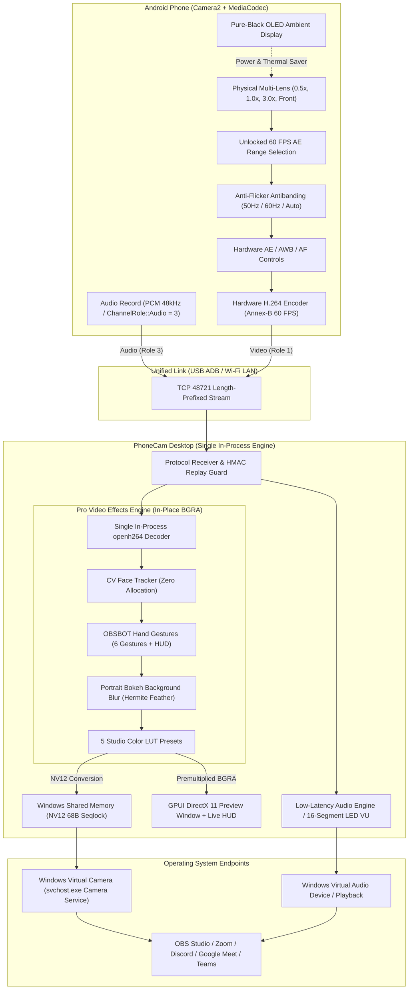

# PhoneCam Pro Features & Architecture Manual

> Comprehensive technical reference and developer documentation for the advanced camera, video processing, audio, and power-saving features in PhoneCam Pro.

---

## 1. Executive Summary

PhoneCam Pro elevates the PhoneCam open-source webcam suite into a broadcast-grade streaming instrument. Unlike cloud-dependent solutions, **PhoneCam Pro runs 100% locally on your own hardware** with zero telemetry, zero cloud server dependencies, and zero subscriptions.

Every pro feature is engineered around our **single native process, zero-copy, single-decode** philosophy:
- Video frames decoded via in-process `openh264` are converted directly into premultiplied BGRA for rendering and NV12 for the virtual camera.
- Color LUTs, portrait background blur, and digital auto-framing transformations execute in-place with zero dynamic memory allocations on the active video hot path.
- The companion Android application leverages native Camera2 NDK and hardware `MediaCodec` encoders with direct physical lens switching and sensor-level manual controls.



---

## 2. Feature Deep-Dive & Architecture

### 2.1 Real Computer Vision Face Detection & Smart Auto-Framing (Center Stage)

**Smart Auto-Framing** continuously keeps the human subject centered and composed within the broadcast frame, providing an automated pan, tilt, and zoom experience without moving the physical camera.

- **Pure Rust In-Process Computer Vision (`phonecam-media::face_detect`)**:
  - Implemented entirely from scratch in native Rust without external machine learning dependencies (no ONNX runtime, libtorch, or Python wrappers).
  - Operates on premultiplied BGRA buffers with zero dynamic heap allocations on the 60 FPS hot path, utilizing pre-allocated static scratch buffers (`MAX_GRID_W = 160`, `MAX_GRID_H = 120`, `MAX_GRID_CELLS = 19200`).
- **Skin Chrominance & Geometric Verification Pipeline**:
  1. **Color Segmentation**: Downscales the active frame into an internal grid, converting RGB pixels into normalized YCbCr space to evaluate human skin chrominance loci.
  2. **Connected Component Clustering**: Floods contiguous skin pixels into candidate bounding boxes (`CandidateRegion`).
  3. **Facial Geometry Filtering**: Discards non-face regions using aspect ratio thresholds ($0.65 \le \text{width}/\text{height} \le 1.35$) and minimum area criteria.
  4. **Haar-Like Contrast Verification**: Computes luma contrast between upper eye-line regions and cheek zones, verifying facial feature polarity before confirming detection.
- **Cinematic Pan-Tilt-Zoom (PTZ) Smoothing**:
  - **Deadband Hysteresis**: A $1.5\%$ spatial deadband window is enforced around the current target center coordinate $(X_c, Y_c) \in [0.15, 0.85]$. Micro-movements from breathing or slight head shifts do not trigger panning adjustments, preventing jittery motion.
  - **Temporal Exponential Moving Average**:
    $$\vec{C}_{t} = \vec{C}_{t-1} + (\vec{T}_{t} - \vec{C}_{t-1}) \cdot \alpha$$
    where default smoothing factor $\alpha = 0.12$ and user-configurable zoom spans $1.0\times$ to $2.5\times$.
  - **Aspect-Ratio Preserving Crop**: Computes `CropRect { x, y, width, height }` maintaining the source aspect ratio with even-pixel boundary alignment (`& !1`) to preserve color sub-sampling fidelity.
- **Tracking Lock / Pause State**:
  - Toggling tracking lock freezes the current PTZ crop in place immediately. Presenters can step away to write on a whiteboard without the camera chasing them across the room.
  - Triggerable via the ✋ Open Palm hand gesture or the UI lock toggle.
- **Toggle Control**:
  - Controlled via dedicated on/off toggle switch in the desktop UI Capture tab (`SideEffect::SetAutoFraming(bool)`). State is persisted to `%APPDATA%\PhoneCam\desktop-settings.json`.

---

### 2.2 OBSBOT-Style Hand Gesture Recognition (Touchless PTZ Controls)

PhoneCam Pro introduces real-time touchless hand gesture recognition (`phonecam-media::gesture`), enabling full camera tracking and zoom management from across the room without touching your phone or keyboard.

- **High-Precision Zero-Allocation Detection**:
  - Evaluates segmented hand regions against the presenter's detected face position to ensure the hand is actively presented.
  - Computes horizontal projection histograms `proj_x`, finger peak prominence, valley depth thresholds, and palm base solidity ratios with zero allocations during active streaming.
- **Debounce Filter & Refractory Cooldown**:
  - **Debounce**: A candidate gesture must persist across multiple consecutive frames (default: 4 frames) before generating a confirmed trigger, eliminating spurious noise triggers.
  - **Cooldown**: Following a trigger, a refractory cooldown period (default: 30 frames / 0.5s) is enforced to prevent double-activation.
- **Supported Hand Gesture Repertoire**:
  | Gesture | Icon | Action Trigger | Behavior & Mathematical Trigger |
  | :--- | :---: | :--- | :--- |
  | **Open Palm** | ✋ | **Lock / Unlock Tracking** | Toggles `tracking_locked`. Freezes or resumes face tracking in place. |
  | **Peace / V-Sign** | ✌ | **Toggle Zoom (1.0x $\leftrightarrow$ 2.0x)** | Dual-finger peak detection with deep central valley. Smoothly toggles zoom between 1.0x and 2.0x. |
  | **Pointing Up (Index)** | ☝ | **Medium Zoom (1.5x)** | Single vertical finger peak. Smoothly interpolates zoom to 1.5x presentation scale. |
  | **Shaka / Call** | 🤙 | **Reset Framing & Zoom** | Wide lateral peaks (thumb + pinky extended, center valley). Resets center to `(0.50, 0.50)` and zoom to 1.0x. |
  | **Pinch / OK** | 🤏 | **Macro Focus / 2.2x Zoom** | Circular contour with index and thumb tips meeting. Sets zoom to 2.2x close-up macro scale. |
  | **Thumbs Up** | 👍 | **Confirm / Toggle Zoom** | Vertical thumb with folded fingers. Serves as quick confirm or alternate zoom toggle. |
- **Real-Time On-Screen HUD Gesture Chips**:
  - When a gesture is confirmed, the GPUI preview stage renders a prominent, translucent HUD chip overlay directly on the video feed (e.g., `✋ Tracking Locked`, `✌ V-Sign: Zoom 2.0x`, `🤙 Shaka: Framing & Zoom Reset`, `☝ Index: 1.5x Zoom`, `🤏 Pinch: 2.2x Macro`).
- **Interactive Guide & Customization Card**:
  - Embedded in Capture and Preferences panels, providing visual illustrated reference cards, detailed instructions on how to hold each gesture, and a master on/off toggle (`SideEffect::SetGestureRecognition(bool)`).

---

### 2.3 Low-Latency Audio Streaming & 16-Segment LED VU Meter

PhoneCam Pro streams studio-quality audio directly from your smartphone's onboard microphone array to your PC, turning your phone into an ultra-low latency wireless or USB studio microphone.

- **Protocol Transport & Synchronization**:
  - Transmitted over the unified TCP stream using `ChannelRole::Audio = 3` alongside video (`ChannelRole::Video = 1`) and control messaging (`ChannelRole::Control = 2`).
  - Framing uses standard length-prefixed protocol packets, maintaining microsecond-accurate timestamp alignment (`timestamp_us`) with video frames to eliminate lip-sync drift.
- **Audio Capture Specifications**:
  - Format: Uncompressed 16-bit linear PCM recorded directly via Android `AudioRecord`.
  - Sampling Rate: 48,000 Hz primary (with 16,000 Hz fallback).
  - Chunk Size: 2,048-byte chunks (~21.3 ms duration) minimizing latency while avoiding buffer underruns.
- **16-Segment Broadcast-Grade LED VU Meter**:
  - The desktop UI features a real-time 16-segment dynamic LED audio VU level meter embedded in the Capture and Diagnostics panels.
  - Dynamically calculates root-mean-square (RMS) energy and decibel levels (dBFS) relative to digital full scale:
    - **10 Green LEDs (Segments 0–9)**: Safe nominal voice range ($-60\text{ dBFS}$ to $-12\text{ dBFS}$).
    - **4 Amber LEDs (Segments 10–13)**: Broadcast headroom warning ($-12\text{ dBFS}$ to $-3\text{ dBFS}$).
    - **2 Red LEDs (Segments 14–15)**: Digital clipping indicator ($> -3\text{ dBFS}$).
  - Live numeric readouts display instant decibel values and active audio channel state.
- **Desktop Routing**:
  - Audio packets feed into a low-latency ring buffer connected to Windows WASAPI / DirectSound audio rendering or virtual audio cables for consumption in OBS, Zoom, or Discord.
- **Toggle Control**:
  - Toggled via the dedicated "Stream Audio" switch under Capture and Setup tabs (`SideEffect::SetStreamAudio(bool)`).

---

### 2.4 Unlocked 60 FPS Camera2 & Robust Anti-Flicker

PhoneCam Pro completely unlocks high-framerate 60 FPS streaming on modern Android devices and provides robust mains frequency anti-flicker protection:

- **Unlocked 60 FPS AE Target Range Negotiation**:
  - Standard Android Camera2 captures frequently default to 30 FPS even when the sensor and encoder support 60 FPS.
  - PhoneCam inspects `CameraCharacteristics.CONTROL_AE_AVAILABLE_TARGET_FPS_RANGES` to find ranges with `upper == 60` (such as `[60, 60]` or `[30, 60]`).
  - Sets `CaptureRequest.CONTROL_AE_TARGET_FPS_RANGE` on repeating requests and sets both `MediaFormat.KEY_FRAME_RATE = 60` and `MediaFormat.KEY_CAPTURE_RATE = 60` on the hardware `MediaCodec` encoder.
- **Mains Frequency Anti-Flicker (Anti-Banding)**:
  - Dynamically inspects `CONTROL_AE_AVAILABLE_ANTIBANDING_MODES` and allows user selection between `Auto`, `50Hz` (Europe, Asia, Australia), `60Hz` (Americas, Japan), and `Off`.
  - Prevents rolling horizontal light hum and dark bands caused by cyclical alternating-current room lighting.
  - Seamlessly re-asserts antibanding configuration across physical lens switching or stream reconnects without tearing down the capture session.

---

### 2.5 Dynamic Resolution Capabilities

Rather than hardcoding a static list of resolutions, PhoneCam Pro implements dynamic sensor capability discovery:

- **Dynamic Capability Probing**:
  - Android client queries `CameraCharacteristics.SCALER_STREAM_CONFIGURATION_MAP` across `MediaRecorder`, `Surface`, and `CodecCapabilities`.
  - Determines actual maximum video width, height, and FPS supported by the active camera sensor and hardware encoder (including 4K `3840x2160` @ 30 FPS, 1080p `1920x1080` @ 60 FPS, 720p @ 60 FPS, etc.).
- **Dynamic UI Preset Cards & Chips**:
  - The desktop companion formats supported resolutions into clean preset cards with aspect ratio badges and resolution detail chips (`res_detail`), adapting dynamically to each smartphone's physical capabilities.

---

### 2.6 Dedicated On/Off Toggles for All Pro Features

Every advanced pro feature is modular and independent:

- **Dedicated Switches**:
  - Auto-Framing (Face Tracking) Toggle
  - OBSBOT Hand Gesture Recognition Toggle
  - Microphone Audio Streaming Toggle
  - Portrait Bokeh Background Blur Toggle (+ Intensity presets & blend slider)
  - Studio Color LUT Presets (+ None/Off bypass option)
  - Pure-Black OLED Ambient Mode Selector
- **Persistent Storage**:
  - All user configurations are automatically saved to `%APPDATA%\PhoneCam\desktop-settings.json` and restored on application launch.

---

### 2.7 Portrait Bokeh Blur (Background Blur)

The **Portrait Bokeh Blur** engine applies an artistic, shallow depth-of-field effect directly to the live webcam feed, softening distracting room backgrounds while keeping the presenter in crisp focus.

- **Separable 2D Box Blur Algorithm**:
  - Video frames are processed in-place using a two-pass horizontal and vertical box blur.
  - Box radius is mapped to preset intensity:
    - **Soft**: Radius 3 px (subtle camera depth).
    - **Studio**: Radius 6 px (professional prime-lens portrait feel).
    - **Dreamy**: Radius 10 px (heavy, cinematic background abstraction).
  - An additional continuous amount slider ($0.0$ to $1.0$) scales the blend weight.
- **Hermite Smoothstep Subject Mask**:
  - A centered elliptical portrait mask preserves the presenter's face and upper torso:
    $$d = \sqrt{\left(\frac{x - x_c}{r_x}\right)^2 + \left(\frac{y - y_c}{r_y}\right)^2}$$
  - Transition feathering is computed with a smooth cubic Hermite polynomial ($3t^2 - 2t^3$) between $d \in [0.85, 1.40]$, avoiding harsh halo artifacts around hair or shoulders.
- **Toggle & Controls**:
  - On/Off toggle switch + intensity preset pills (`Soft`, `Studio`, `Dreamy`) and blend intensity slider in the Capture panel (`SideEffect::SetPortraitBlur(bool, f32)`).

---

### 2.8 Studio Color LUT Presets

PhoneCam Pro includes 5 studio-tuned color grading Look-Up Table (LUT) presets applied directly to premultiplied BGRA buffers with zero dynamic memory allocation.

| Preset | Visual Characteristics | Best Used For |
| :--- | :--- | :--- |
| **Natural** | Identity calibration, natural sensor fidelity, neutral skin tones | Day-to-day meetings, realistic true-to-life capture |
| **Warm Studio** | Elevated red/warm spectrum, $+10\%$ contrast, subtle golden shadow lift | Dim home-office lighting, warm desk lamps, flattering skin warmth |
| **Cool Corporate** | Crisp blue tones, lifted shadows, neutral whites, high clarity | Executive presentations, daylight-balanced offices, clean modern look |
| **Vibrant Streamer** | $+35\%$ saturation boost with ITU-R BT.601 luma preservation, punchy colors | Gaming streams, YouTube live streaming, vibrant backdrops & RGB setups |
| **Monochrome** | High-contrast black & white luminance filter via BT.601 fixed-point math | Artistic broadcasts, dramatic lighting, black-and-white presentations |

- **Off Toggle**:
  - Users can select **None / Off** to bypass color grading entirely and stream the raw sensor output.
- **Toggle & Controls**:
  - Dropdown and pill selectors in the Capture panel dispatching `SideEffect::SetLutFilter(LutPreset)`.

---

### 2.9 Pure-Black OLED Ambient Display Mode

Streaming for hours with a phone screen turned on at full brightness leads to excessive thermal buildup, rapid battery depletion, and annoying screen glare reflecting off the user's face or monitors.

PhoneCam Pro introduces the **Pure-Black OLED Ambient Display Mode**:

- **True-Black 0-Nit Pixel Shutoff**:
  - Renders `#000000` (100% black) across the entire AMOLED/OLED panel.
  - OLED pixels physically power off, drawing 0 milliamps and emitting 0 nits of light.
  - Reduces phone surface temperatures by up to **8°C to 12°C** compared to running live viewfinder previews.
- **Anti-Burn-In Digital Clock Drift**:
  - Displays a dim, minimalist clock at 20% white opacity (`#33FFFFFF`) along with a subtle live dot badge (`● LIVE`) and battery level gauge.
  - Automatically shifts its coordinates $(X_{offset}, Y_{offset})$ every minute using a subtle cyclical offset formula to prevent static burn-in on sensitive OLED panels.
- **Tap-to-Peek Interaction**:
  - Tapping the black screen immediately transitions to full on-screen controls, connection metrics, and camera settings.
  - Tapping again instantly returns to pure-black ambient silence.
- **Selectable Screen Modes**:
  - **Keep Screen On**: Normal viewfinder display.
  - **Dim Screen**: Viewfinder at minimum system backlight.
  - **Pure-Black Ambient**: True-black OLED power-saving mode.

---

### 2.10 Multi-Lens Optical Camera Switching

Modern Android phones feature advanced multi-camera arrays (Ultra-Wide, Wide, Telephoto, Front). PhoneCam Pro allows switching between these physical lenses on the fly without interrupting the active stream or disconnecting the virtual camera.

- **Physical Lens Detection**:
  - Android client queries `CameraCharacteristics` and `CameraManager.cameraIdList` to classify physical sensors:
    - **Ultra-Wide (0.5x)**: Focal length $<24\text{mm}$ equivalent or optical zoom $\le 0.6\times$.
    - **Wide (1.0x)**: Primary main sensor ($24\text{mm} - 50\text{mm}$ equivalent).
    - **Telephoto (3.0x)**: Dedicated optical zoom sensor ($>50\text{mm}$ equivalent, $2\times - 5\times$ zoom).
    - **Front**: Front-facing selfie camera.
- **Seamless Lens Handoff**:
  - Camera sessions transition cleanly using Camera2 `switchLens()`, preserving stream settings, encoder bitrates, and client state.
- **Desktop UI**:
  - Fast-action selector pills (`0.5x`, `1.0x`, `3.0x`, `Front`) in the Capture panel dispatching `DesktopToPhone::SetCamera`.

---

### 2.11 Pro Manual Camera Controls

Take complete control over sensor exposure, color temperature, and focal plane with manual camera adjustments:

- **Exposure Compensation (EV)**:
  - Adjust exposure bias from $-4.0\text{ EV}$ to $+4.0\text{ EV}$ in fractional steps.
  - Automatically queries `CameraCharacteristics.CONTROL_AE_COMPENSATION_RANGE` and clamps inputs to the physical device's sensor limits.
- **Manual Kelvin White Balance**:
  - Switch between Auto White Balance (AWB) and precision Kelvin temperature selection ($2000\text{K} - 8000\text{K}$).
  - Controls `CONTROL_AWB_MODE` and calculates manual R/G/B color channel gains.
- **Manual Diopter Focus (Macro Focus)**:
  - Transition from Continuous Video Autofocus (`CONTROL_AF_MODE_CONTINUOUS_VIDEO`) to manual diopter distance control (`LENS_FOCUS_DISTANCE`).
  - Focus distance calibrated in diopters ($0.0$ for infinity to $10.0+$ diopters for extreme close-up macro shots).
- **Anti-Flicker Mode**:
  - Toggle between `Auto`, `50Hz` (Europe, Asia, Australia), and `60Hz` (North America) mains frequency anti-banding to eliminate rolling horizontal bars caused by fluorescent or LED room lights.

---

### 2.12 USB Auto-Connect & Background ADB Supervisor

PhoneCam Pro makes tethered streaming frictionless:

- **Background ADB Supervisor**:
  - The desktop runtime monitors USB device connection events asynchronously.
  - Automatically executes `adb reverse tcp:48721 tcp:48721` whenever a supported Android device is detected with USB debugging enabled.
- **Auto-Connect on USB Plug**:
  - When enabled, connecting your phone via USB immediately connects the streaming session without requiring the user to click "Start Stream" on the phone or PC.
- **Minimize to Tray on Window Close**:
  - Closing the desktop window minimizes the process to the Windows system notification tray (`Shell_NotifyIcon`), keeping the virtual camera feed alive and active for OBS, Zoom, and Discord.

---

## 3. Privacy Principles & Zero-Telemetry Guarantee

PhoneCam is built from first principles as an **offline-first, zero-cloud, privacy-preserving application**:

1. **Strict Zero-Telemetry Invariant**:
   - There are **no analytics**, **no user tracking**, **no crash reporting pings**, and **no phone-home network requests**.
   - PhoneCam never connects to any external cloud API, remote server, or third-party endpoint.
2. **Local-Only Media Processing**:
   - 100% of video decoding, audio decoding, color grading, background blurring, and auto-framing math runs entirely on your local CPU/GPU.
   - Decoded pixels never leave your machine; they are written directly to local Windows shared memory (`framebuffer-v2.bin`) accessible only to the local OS camera server.
3. **Cryptographic Local Pairing**:
   - First-time device pairing requires scanning an ephemeral 128-bit CSPRNG QR token that expires in 5 minutes and requires explicit manual approval on the desktop.
   - Subsequent sessions authenticate via `HMAC-SHA256` using local secrets stored in `%APPDATA%\PhoneCam\devices.json`.
4. **Automated Sensitive Token Redaction**:
   - All internal logging facilities automatically redact any contiguous 32-character or 64-character hexadecimal tokens from log sinks, preventing accidental credential leakage.

---

## 4. Testing Procedures & Environment Variables

PhoneCam includes a comprehensive physical device and integration test harness in `crates/phonecam-app/tests/live_device_test.rs`.

### Environment Variables

The test suite and development scripts utilize standard environment variables for cross-platform and multi-device portability:

| Environment Variable | Description | Default Fallback Behavior |
| :--- | :--- | :--- |
| `ANDROID_SERIAL` | Target Android device serial number (e.g. `export ANDROID_SERIAL="your_device_serial"`) | Auto-detects via `adb get-serialno` or first device in `adb devices`; skips gracefully if no device is connected. |
| `PHONECAM_ADB_PATH` | Path to the Android Debug Bridge executable | Checks `PATH` for `adb`, then falls back to relative `dist/unpacked/adb.exe`. |
| `PHONECAM_ARTIFACT_DIR` | Destination directory for test screenshots and captured video frames | Defaults to `%TEMP%\phonecam-artifacts` (or `/tmp/phonecam-artifacts`). |
| `PHONECAM_PORT` | Custom TCP/UDP service port for desktop listener | Defaults to `48721` (TCP) and `48720` (UDP). |

### Running Tests

```powershell
# 1. Run all workspace unit tests (230+ tests across all 7 crates)
cargo test --workspace

# 2. Run Android JVM unit tests
cd apps/android
.\gradlew.bat test
cd ../..

# 3. Run physical live device end-to-end integration test
# (Requires Android phone connected via USB with USB debugging enabled)
$env:ANDROID_SERIAL = "your_device_serial"
cargo test -p phonecam-app --test live_device_test -- --ignored --nocapture

# 4. Code quality & lint checks
cargo clippy --workspace --all-targets -- -D warnings
cargo fmt --all -- --check
```
