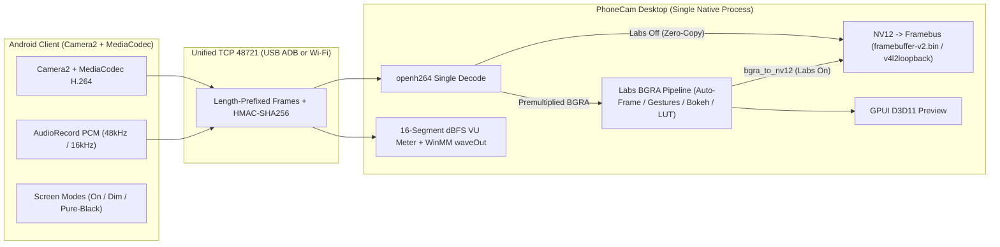

# PhoneCam Pro & Labs Features Reference

This document describes the camera controls, Windows audio routing, and experimental Labs video processing available in PhoneCam, matching the actual implementation across `phonecam-media`, `phonecam-ui`, `phonecam-app`, `native/`, and `apps/android`.

> **Pipeline Scope Note:**
> - **Labs Visual Effects** (`Auto-Framing`, `Hand Gestures`, `Portrait Bokeh`, `Color LUTs`) are **off by default**. When all visual effects are off, `phonecam-app` writes decoded YUV directly to NV12 shared memory with zero extra copies. When **any** visual effect is enabled, `phonecam-app` runs the pre-allocated BGRA CV/effects pass even while minimized to the tray and converts the result back via `bgra_to_nv12` so **Virtual Camera consumers (OBS/Zoom/Discord) see the exact same output as the GPUI preview**.
> - **Audio Monitor & `waveOut` Routing** drives a 16-segment dBFS VU meter and can route 16-bit PCM to **VB-Audio Virtual Cable (`CABLE Input`)** or Windows playback devices via `crates/phonecam-app/src/audio_out.rs`; a native kernel virtual microphone driver remains on the Roadmap.

---

## 1. Pipeline Overview

---

## 2. Camera & Streaming Controls (Production)

### Unlocked Framerate & Dynamic Capabilities
- **Capability Probing**: Android queries `CameraCharacteristics.SCALER_STREAM_CONFIGURATION_MAP`, `CONTROL_ZOOM_RATIO_RANGE`, and hardware `MediaCodec` `CodecCapabilities` to report supported resolutions, zoom bounds (including `< 1.0x` ultrawide when supported), and framerates dynamically.
- **AE FPS Range Selection**: Camera2 inspects `CONTROL_AE_AVAILABLE_TARGET_FPS_RANGES` to select 60 FPS ranges when supported by the device sensor and current mode, and 30 FPS ranges otherwise.
- **Anti-Flicker (Antibanding)**: Queries `CONTROL_AE_AVAILABLE_ANTIBANDING_MODES` (`Auto`, `50Hz`, `60Hz`, `Off`) to suppress AC lighting flicker bands across lens switches.
- **Manual Controls**: Exposure compensation (`EV`), White Balance (`Auto` or Kelvin temperature with `COLOR_CORRECTION_TRANSFORM`), Focus (`Continuous` or manual diopter distance), Digital Zoom, Flash/Torch, Horizontal Mirror, 90°/180°/270° Rotation, and Auto-Rotate from physical phone orientation.

### Pure-Black OLED Ambient Display Mode
- Renders true `#000000` black across AMOLED/OLED displays to eliminate viewfinder glare and reduce display power draw/heat during long calls while retaining `FLAG_KEEP_SCREEN_ON`.
- Shows a low-opacity status readout (`#33FFFFFF` clock, battery, live badge) with periodic minute-level position drift to mitigate burn-in, plus a non-blocking tap-to-peek bar (`Re-dim` / `Exit Blackout` with 5s auto-dim).
- Selectable screen modes: **Keep Screen On**, **Dim Screen**, and **Pure-Black Ambient**.

### Adaptive Bitrate & Quality Ladder
- Desktop `AdaptiveQuality` monitors round-trip latency (`rttUs > 0`), packet drop rate (`PhoneStats.dropped`), and phone thermal state over `1080p60 -> 1080p30 -> 720p30 -> 480p30`.
- Step-down uses a 10-second dwell (instant on critical thermal alert); step-up requires 30 seconds of clean measured stats and never exceeds the user's configured resolution/FPS ceiling.

---

## 3. Audio Monitor & Windows `waveOut` Output (`ChannelRole::Audio = 3`)

- **Capture & Sample Rate Reporting**: Android `AudioRecord` captures uncompressed 16-bit little-endian mono PCM (`48,000 Hz` primary, `16,000 Hz` fallback), streams packets over `ChannelRole::Audio = 3` on TCP `48721`, and reports `audioSampleRate` in `PhoneMessage.State`.
- **Desktop VU Meter**: `phonecam-app` computes RMS and dBFS levels to drive a 16-segment logarithmic dBFS VU meter in the UI (10 green nominal segments `-60` to `-12 dBFS`, 4 amber headroom segments `-12` to `-3 dBFS`, 2 red clipping segments `> -3 dBFS`).
- **Windows `waveOut` Playback Routing (`crates/phonecam-app/src/audio_out.rs`)**:
  - Defaults to **Monitor Only** (`None` / `"monitor_only"`) so speakers never cause accidental microphone feedback.
  - Selecting a playback device (prioritizing virtual audio cables such as VB-Audio Virtual Cable `"CABLE Input"`, `"VB-Audio"`, `"VoiceMeeter"`, or `"default"` / named Windows playback devices) routes incoming PCM through an 8-slot pre-allocated WinMM `waveOut` ring buffer (`RING_SLOTS = 8`, `SLOT_CAPACITY_BYTES = 4096`) with zero per-packet heap allocations.
- **Roadmap**: A native OS-level **kernel virtual microphone driver** (avoiding third-party virtual audio cables like VB-Cable) remains on the Roadmap.

---

## 4. Experimental (Labs) — Local CV & Video Effects

All Labs visual features live in `crates/phonecam-media` (`face_detect.rs`, `gesture.rs`, `effects.rs`), execute 100% locally in pure Rust with pre-allocated scratch buffers (`EffectsScratch`) and no external ML runtimes (no ONNX/libtorch/OpenCV), and are **disabled by default**.

### 4.1 Heuristic Face Detection & Auto-Framing (`phonecam-media::face_detect`)
- **How it works**: Downsamples BGRA frames into a pre-allocated scratch grid (`MAX_GRID_W = 160`, `MAX_GRID_H = 120`), segments skin-tone regions in normalized YCbCr space, clusters connected components (`CandidateRegion`), filters by aspect ratio (`0.65..=1.35`), and checks upper-eye vs cheek luma contrast.
- **PTZ Smoothing**: Applies a 1.5% spatial deadband, dt-compensated exponential temporal smoothing, bilinear crop scaling (`crop_bgra_with_scratch`), even-aligned crop bounds (`& !1`), and tracking lock/pause state.
- **Known limitations**: Because detection relies on YCbCr skin chrominance + contrast heuristics rather than a neural face detector, accuracy depends on lighting and background colors.

### 4.2 Hand Gesture Recognition (`phonecam-media::gesture`)
- **How it works**: Evaluates candidate hand regions relative to the detected face using horizontal projection histograms (`proj_x`), finger peak prominence, valley depth, and solidity ratios, gated by a 7-frame debounce and cooldown window.
- **6 Gestures**:
  - **Open Palm**: Lock / unlock tracking
  - **Peace / V-Sign**: Toggle zoom (`1.0x <-> 2.0x`)
  - **Pointing Up**: Medium zoom (`1.5x`)
  - **Shaka / Call**: Reset framing and zoom (`1.0x`)
  - **Pinch / OK**: Close-up zoom (`2.2x`)
  - **Thumbs Up**: Alternate zoom toggle / confirm
- **Status**: Off by default in Labs; emits translucent HUD chips on the desktop preview stage when enabled.

### 4.3 Portrait Bokeh Blur (`phonecam-media::effects`)
- **How it works**: Zero-allocation separable sliding-window $O(W \cdot H)$ box blur masked around the detected face region (falling back to `(0.50, 0.45)`) with cubic Hermite feathering ($3t^2 - 2t^3$) — it is a geometric/face-centered mask rather than neural person segmentation.
- **Presets**: `Soft`, `Studio`, and `Dreamy`, plus a blend slider (`0.0..=1.0`).

### 4.4 Color LUT Presets (`phonecam-media::effects`)
- **How it works**: In-place per-pixel color transforms on premultiplied BGRA frames.
- **Presets**: `None / Off`, `Natural`, `Warm Studio`, `Cool Corporate`, `Vibrant Streamer`, and `Monochrome`.

---

## 5. Privacy & Local-Only Operation

- **Zero Telemetry**: No analytics, crash pings, or cloud endpoints.
- **Local Auth**: Ephemeral 128-bit CSPRNG QR pairing token (5-minute TTL, single-use) + persistent 256-bit secret stored in `%APPDATA%\PhoneCam\devices.json` for `HMAC-SHA256` challenge-response with monotonic `u64` replay protection.
- **Log Redaction**: `redact()` strips contiguous hexadecimal runs of 32+ characters before writing logs.
